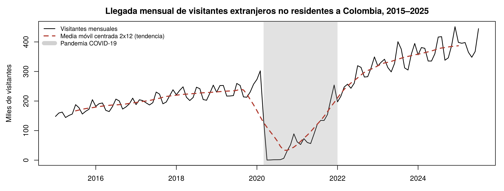
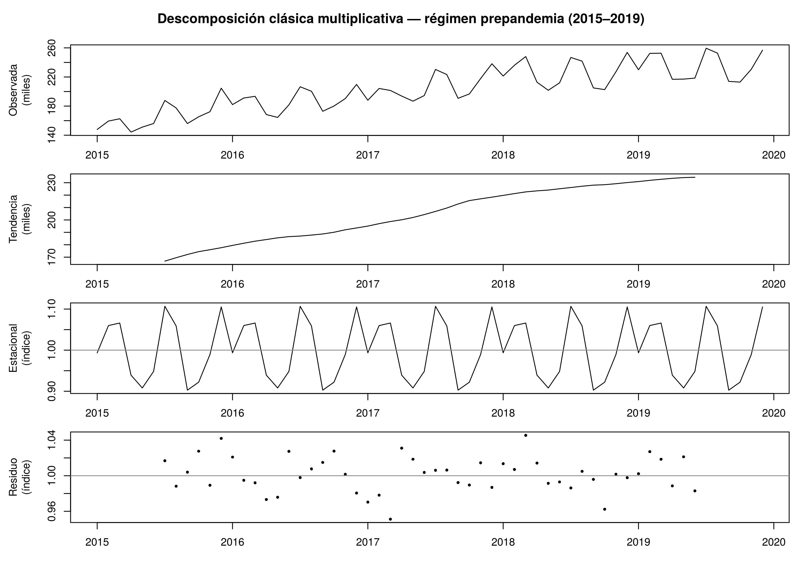
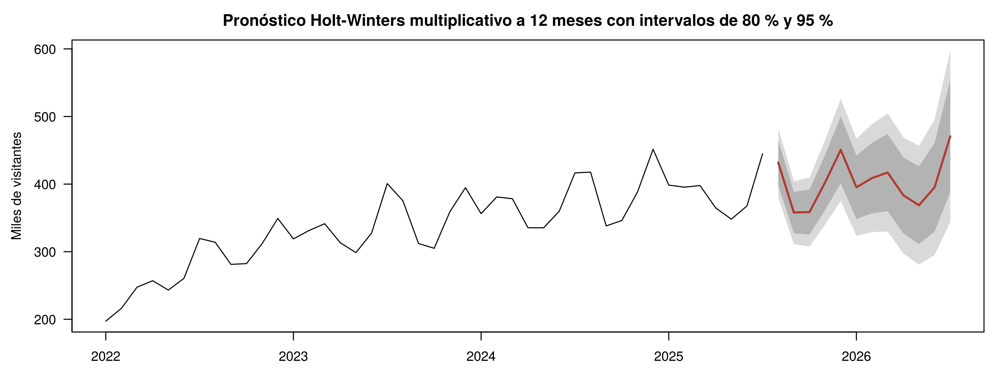

# Pronóstico de la llegada de turistas extranjeros a Colombia con series de tiempo

Análisis y pronóstico de la serie mensual de **visitantes extranjeros no residentes que llegan a Colombia (enero 2015 – julio 2025)**, desarrollado en **R / RStudio**.

> Actividad sumativa · Unidad 4 · Módulo *Inferencia Avanzada y Análisis Multivariado* · Politécnico Grancolombiano · Noviembre de 2026
>
> **Integrantes:** Ana Milena Uribe, Alejandro Quintero, Francisco Mario Campo, Pablo Stevens Casilimas · **Docente:** Jaime Edison Rojas Mora

📄 **[Informe técnico en formato APA (PDF)](informe/Informe_Series_Tiempo_Turistas.pdf)** · ✏️ **[Texto editable del informe](informe/informe.md)** · 📊 **[Reporte completo con código y gráficas (HTML)](docs/index.html)** · 💻 **[Código fuente (R Markdown)](Series_Tiempo_Turistas_Colombia.Rmd)**



## Objetivo

Identificar los componentes de la serie (tendencia, estacionalidad, ciclos y ruido), descomponerla, comparar técnicas de pronóstico y proyectar la llegada de visitantes para los siguientes 12 meses.

## Datos

| | |
|---|---|
| **Fuente** | [Datos Abiertos Colombia – *Extranjeros No Residentes*](https://www.datos.gov.co/Comercio-Industria-y-Turismo/Extranjeros-No-Residentes/7wm8-w5ad) (MinCIT con registros de Migración Colombia) |
| **Registros originales** | 466.915 (año, mes, ciudad de destino, país de residencia) |
| **Serie analizada** | 127 observaciones mensuales del total nacional (`data/turistas_colombia_mensual.csv`) |
| **Periodo** | Enero 2015 – julio 2025 (la versión del conjunto utilizada llega hasta julio de 2025; por eso el pronóstico de ago-2025 a jul-2026 es retrospectivo y se contrasta con cifras oficiales posteriores) |

El código para reconstruir el CSV desde la fuente original está en el anexo del archivo `.Rmd`.

## Metodología

1. **Análisis exploratorio:** visualización, perfil estacional, amplitud estacional frente al nivel, ciclos y ruido.
2. **Estacionariedad:** pruebas ADF y KPSS, ACF y PACF, diferenciación regular y estacional.
3. **Descomposición:** clásica aditiva frente a multiplicativa (régimen prepandemia y pospandemia) y STL robusta de la serie completa.
4. **Pronóstico:** ingenuo estacional, medias móviles (k = 3 y 12), suavizamiento exponencial simple, Holt y Holt-Winters aditivo y multiplicativo.
5. **Evaluación:** conjunto de prueba de 6 meses, validación con origen móvil (48 errores por método) y contraste con cifras oficiales publicadas después del corte de los datos.

## Resultados principales

| Hallazgo | Resultado |
|---|---|
| Modelo de descomposición | **Multiplicativo**: la amplitud estacional crece con el nivel |
| Estacionalidad | Picos en diciembre y julio–agosto; valles en mayo y septiembre. Estable antes y después de la pandemia (correlación de índices = 0,97) |
| Mejor método | **Holt-Winters multiplicativo** (MAPE 5,6 % en validación con origen móvil) |
| Pronóstico ago-2025 a jul-2026 | ≈ 4,84 millones de visitantes |
| Validación con datos reales | Agosto y septiembre de 2025 quedaron dentro del intervalo de predicción del 95 % |





## Estructura del repositorio

```
├── Series_Tiempo_Turistas_Colombia.Rmd   # Código fuente comentado (R Markdown)
├── series-tiempo-turistas-colombia.Rproj # Proyecto de RStudio
├── data/
│   └── turistas_colombia_mensual.csv     # Serie mensual agregada
├── docs/
│   └── index.html                        # Reporte generado con Knit (copia del HTML)
├── figuras/                              # Gráficas generadas por el análisis
└── informe/
    ├── informe.md                        # Texto editable del informe (formato APA)
    ├── generar_pdf_apa.py                # Convierte informe.md en el PDF con formato APA 7
    └── Informe_Series_Tiempo_Turistas.pdf
```

## Cómo replicar el análisis

1. Clonar o descargar el repositorio (botón **Code → Download ZIP**).
2. Abrir `series-tiempo-turistas-colombia.Rproj` en RStudio.
3. Instalar los paquetes (solo la primera vez):
   ```r
   install.packages(c("forecast", "tseries", "knitr", "jsonlite", "rmarkdown"))
   ```
4. Abrir `Series_Tiempo_Turistas_Colombia.Rmd` y presionar **Knit**. Se regeneran las figuras de `figuras/` y se crea `Series_Tiempo_Turistas_Colombia.html`; para actualizar el reporte publicado, cópielo a `docs/index.html`.

## Cómo editar el informe y regenerar el PDF

El informe está en `informe/informe.md` y se puede editar directamente en GitHub (ícono del lápiz). Sus figuras se leen de `figuras/`, así que se actualizan solas al volver a hacer Knit. Las cifras del texto y de las tablas están escritas a mano: si cambia el análisis, hay que actualizarlas.

Para generar el PDF con formato APA 7 (portada, Times New Roman 12, doble espacio, tablas y figuras APA) se necesita Python:

```bash
pip install reportlab markdown-it-py pillow
python informe/generar_pdf_apa.py
```

Los datos de la portada (título, integrantes, institución, curso, docente y fecha) están en el bloque inicial de `informe.md`, entre las líneas `---`.

Probado con R 4.3 y el paquete `forecast`.

## Referencias

- Gujarati, D. N. (2004). *Basic econometrics* (4.ª ed.). McGraw-Hill.
- Hyndman, R. J., y Athanasopoulos, G. (2021). *Forecasting: Principles and practice* (3.ª ed.). OTexts.
- Montgomery, D. C., Jennings, C. L., y Kulahci, M. (2015). *Introduction to time series analysis and forecasting* (2.ª ed.). Wiley.
- Rojas Mora, J. E. (s. f.). *Series de tiempo* [Lectura fundamental, Unidad 4]. Politécnico Grancolombiano.
- Wooldridge, J. M. (2013). *Introductory econometrics: A modern approach* (5.ª ed.). Cengage.
