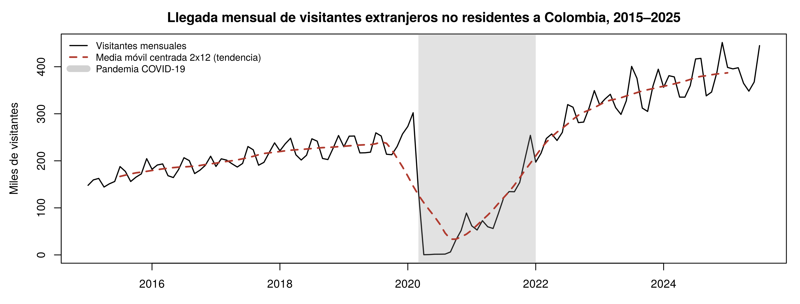
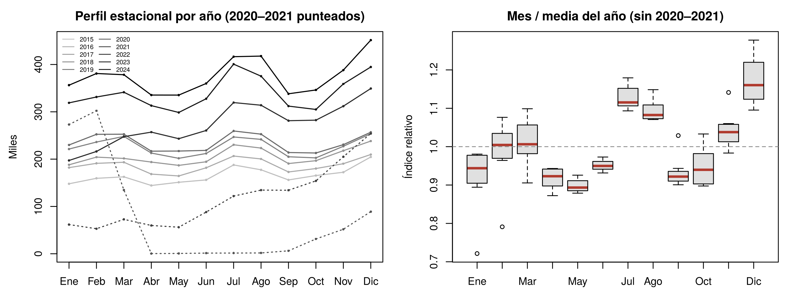
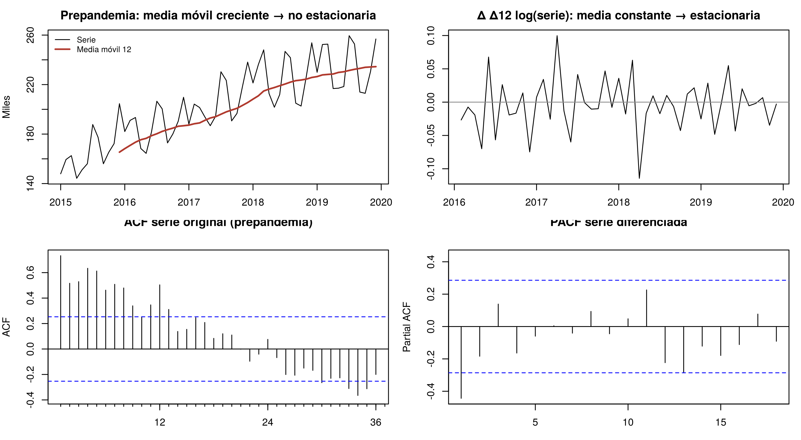
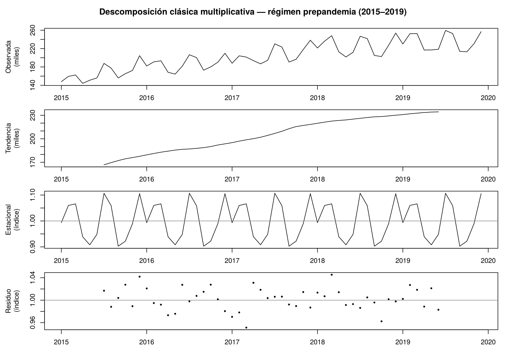
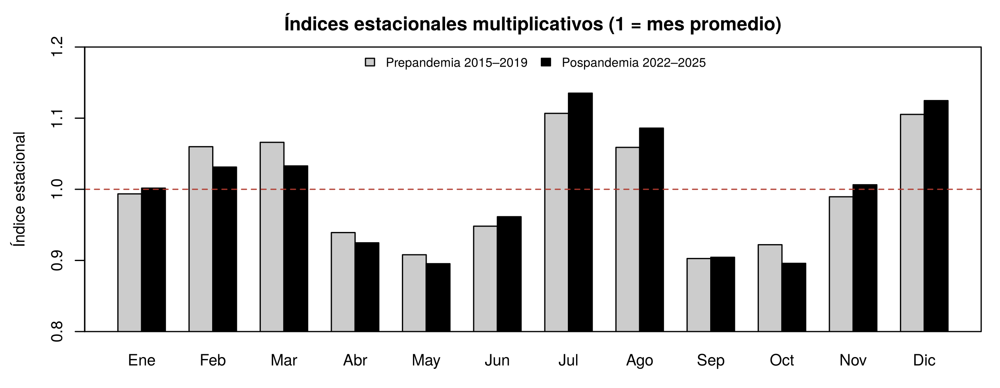
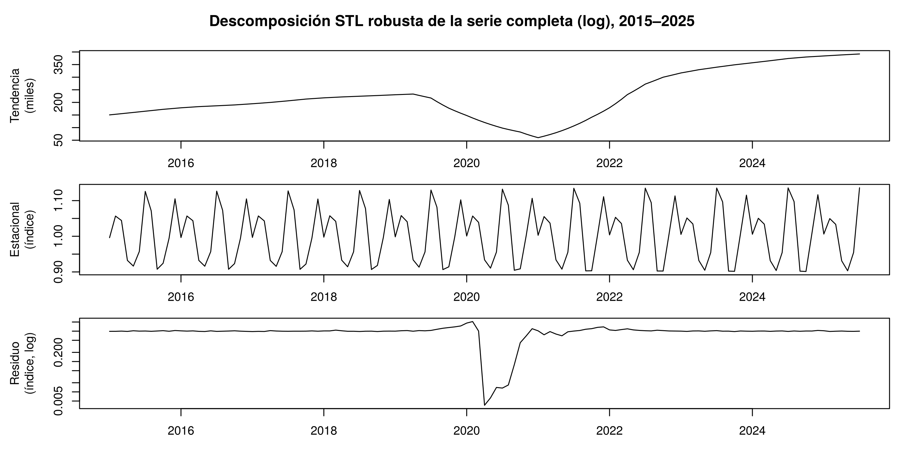
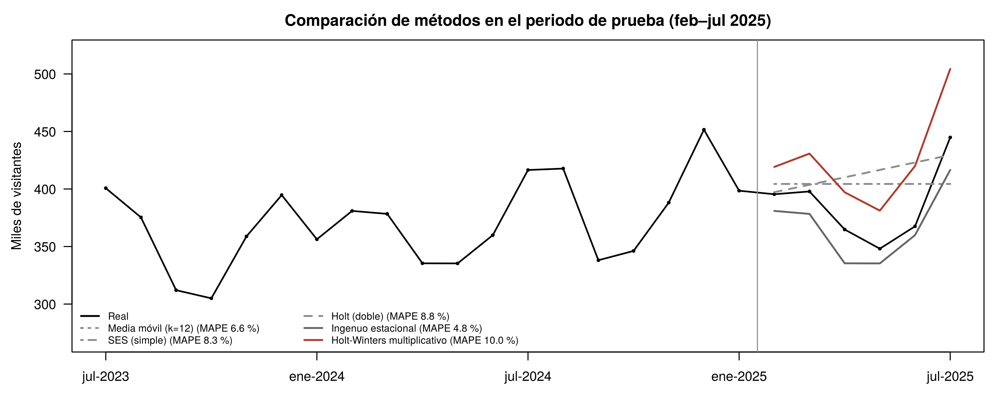
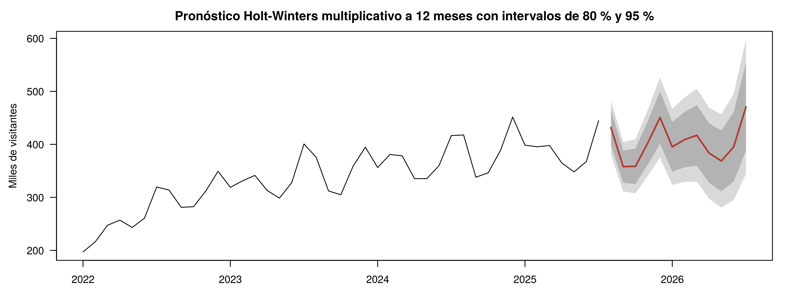

<!--
GUÍA RÁPIDA PARA EDITAR ESTE INFORME
- Los datos de la portada están en el bloque de arriba (entre las líneas ---).
- # = encabezado de nivel 1 (APA: centrado, negrita); ## = nivel 2; ### = nivel 3.
- Tablas y figuras siguen el patrón APA: **Tabla N** / *Título en cursiva* / tabla o imagen / *Nota.* texto.
- Las figuras se leen de la carpeta ../figuras/, que se regenera al hacer Knit del .Rmd.
- Un comentario HTML con la palabra «salto» fuerza un salto de página en el PDF.
- Para generar el PDF: python informe/generar_pdf_apa.py
-->

# Resumen

Se analiza la serie mensual de visitantes extranjeros no residentes que llegaron a Colombia entre enero de 2015 y julio de 2025 (127 observaciones). La serie combina una tendencia creciente, una estacionalidad anual marcada (picos en diciembre, julio y agosto) y un cambio estructural por la pandemia. La descomposición indica que el modelo multiplicativo es el adecuado y que el patrón estacional se mantuvo casi idéntico antes y después de la pandemia (correlación de los índices = 0,969). Se compararon siete métodos de pronóstico, y Holt-Winters multiplicativo obtuvo el menor error en la validación con origen móvil (MAPE = 5,6 %). Como los datos disponibles terminan en julio de 2025, el pronóstico a 12 meses (agosto de 2025 a julio de 2026) se plantea como un ejercicio retrospectivo: suma 4.841.021 visitantes, y los valores oficiales de agosto y septiembre de 2025, publicados después del corte, quedaron dentro de su intervalo de predicción del 95 %.

*Palabras clave:* series de tiempo, descomposición multiplicativa, Holt-Winters, pronóstico, turismo

<!-- salto -->

# Modelamiento y pronóstico de la llegada mensual de visitantes extranjeros no residentes a Colombia, 2015–2025

El turismo internacional es una de las principales fuentes de divisas de Colombia, y anticipar cuántos visitantes llegarán cada mes es clave para planear la capacidad hotelera y aeroportuaria, la contratación temporal y las campañas de promoción. Como señalan Montgomery et al. (2015), un pronóstico preciso es la base de la planeación estratégica en estos ámbitos. Siguiendo el enfoque de la lectura fundamental de la unidad (Rojas Mora, s. f.), este informe describe primero los componentes de la serie (tendencia, estacionalidad, ciclos y ruido), la descompone y, con ese conocimiento, compara técnicas de suavizamiento para pronosticarla.

# Método

## Datos

Se utilizó el conjunto *Extranjeros No Residentes* de Datos Abiertos Colombia (datos.gov.co, id 7wm8-w5ad), publicado por el Ministerio de Comercio, Industria y Turismo (MinCIT) con registros de Migración Colombia. El archivo original tiene 466.915 registros por año, mes, ciudad de destino y país de residencia; se agregó a un total nacional mensual, con lo que se obtiene una serie de 127 meses (enero de 2015 a julio de 2025), sin datos faltantes. La serie cumple con creces el mínimo de 60 observaciones.

La versión del conjunto de datos utilizada llega hasta julio de 2025. Por eso, el pronóstico de agosto de 2025 a julio de 2026 se plantea como un ejercicio retrospectivo: se estima solo con la información disponible hasta julio de 2025, como se habría hecho en ese momento, y después se contrasta con las cifras oficiales publicadas para agosto y septiembre de 2025.

## Procedimiento

El análisis se realizó en R con los paquetes `forecast` (Hyndman y Athanasopoulos, 2021) y `tseries`. El archivo `Series_Tiempo_Turistas_Colombia.Rmd` reproduce cada cifra, tabla y figura de este informe. Se siguieron cuatro etapas: (a) análisis exploratorio y pruebas de estacionariedad; (b) descomposición clásica aditiva y multiplicativa, complementada con STL; (c) ajuste y comparación de siete métodos de pronóstico con un conjunto de prueba y una validación con origen móvil; y (d) pronóstico a 12 meses con el mejor método.

# Resultados

## Análisis exploratorio de la serie

### Visualización y tendencia

**Figura 1**

*Serie mensual de visitantes extranjeros no residentes con su tendencia*

*Nota.* La línea discontinua es la media móvil centrada 2×12 (tendencia). La franja gris marca la pandemia (marzo de 2020 a diciembre de 2021).

La serie tiene tres tramos. El primero es de crecimiento sostenido entre 2015 y 2019: el total anual pasó de 1.984.744 a 2.814.025 visitantes, con alzas de 10 % a 13 % anual hasta 2018 y una desaceleración a 3,9 % en 2019. El segundo es el colapso por la pandemia: el cierre de fronteras llevó la serie a un mínimo de 408 visitantes en abril de 2020 (−68,2 % en el año), seguido de una reapertura gradual en 2021. El tercero es de recuperación y récords desde 2022: 4.077.639 visitantes en 2023 y 4.504.530 en 2024, con el máximo histórico de 451.522 en diciembre de 2024. La tendencia de la descomposición crecía unos 1.502 visitantes por mes antes de la pandemia (≈ 8,8 % anual) y unos 3.338 por mes después.

### Estacionalidad

**Figura 2**

*Perfil estacional de la serie*

*Nota.* Izquierda: perfil mensual de cada año. Derecha: valor de cada mes dividido por la media de su año (sin 2020–2021).

El patrón se repite cada año. Los picos están en diciembre y en julio–agosto, que coinciden con las vacaciones de fin de año y el verano del hemisferio norte (Estados Unidos es el principal mercado emisor). Hay un repunte en febrero–marzo, temporada seca y de Semana Santa en algunos años. Los valles están en abril–mayo y septiembre–octubre, temporadas bajas. La amplitud estacional crece con el nivel: el rango entre el mes más alto y el más bajo pasó de 45 a 60 mil visitantes en 2015–2019 a 102 a 116 mil en 2023–2024, con una correlación de 0,70 entre el nivel medio y el rango anual. En cambio, el coeficiente de variación dentro del año se mantiene entre 7,7 % y 10,6 %; 2022 es la excepción (16,4 %), inflado por la recuperación que ocurrió dentro de ese año. Que las oscilaciones sean proporcionales al nivel es la señal típica de un modelo multiplicativo (Gujarati, 2004; Rojas Mora, s. f.).

### Ciclos y ruido

Con poco más de diez años de datos no es posible identificar ciclos económicos regulares, que duran varios años y tienen amplitud variable (Gujarati, 2004). La oscilación de largo plazo más visible es el choque de la pandemia, que se trata como un cambio estructural y no como un ciclo. La desaceleración de 2019 y la de 2025 sugieren una sensibilidad del turismo al entorno económico y cambiario. El componente irregular se cuantifica en la descomposición: es pequeño (≈ 2 % del nivel) y aleatorio.

### Estacionariedad

La Tabla 1 resume las pruebas de Dickey-Fuller aumentada (ADF) y KPSS sobre la serie en nivel y transformada, por régimen.

**Tabla 1**

*Pruebas de estacionariedad*

| Serie | *n* | *p* ADF | *p* KPSS | Conclusión |
| :--- | :---: | :---: | :---: | :--- |
| Prepandemia (nivel) | 60 | 0,025 | 0,010 | No concluyente |
| Prepandemia (log) | 60 | 0,053 | 0,010 | No estacionaria |
| Prepandemia Δ log | 59 | 0,010 | 0,100 | Estacionaria |
| Prepandemia Δ Δ12 log | 47 | 0,010 | 0,100 | Estacionaria |
| Pospandemia (nivel) | 43 | 0,088 | 0,010 | No estacionaria |
| Pospandemia Δ Δ12 log | 30 | 0,013 | 0,078 | Estacionaria |

*Nota.* ADF: H0 = raíz unitaria (no estacionaria); KPSS: H0 = estacionaria en nivel. El paquete `tseries` trunca los valores *p* de KPSS en 0,01 y 0,10.

**Figura 3**

*Diagnóstico visual de estacionariedad*

*Nota.* Arriba: media móvil de la serie prepandemia y serie diferenciada (Δ Δ12 log). Abajo: ACF de la serie original y PACF de la serie diferenciada.

En niveles, la serie no es estacionaria en media. KPSS rechaza la estacionariedad en todos los casos en nivel, la media móvil crece y la ACF decae lentamente con picos en los rezagos 12, 24 y 36, señal de tendencia más estacionalidad. El ADF, que incluye una tendencia determinística, rechaza la raíz unitaria en la serie prepandemia en nivel, lo que indica una serie estacionaria alrededor de una tendencia. Tras aplicar logaritmo, una diferencia regular y una estacional, ambas pruebas coinciden en que la serie es estacionaria en los dos regímenes, en línea con `ndiffs` y `nsdiffs`, que sugieren una diferencia de cada tipo. Esto confirma que la no estacionariedad se debe a la tendencia y la estacionalidad, los componentes que se modelan a continuación; ignorarlos llevaría a inferencias espurias (Wooldridge, 2013).

## Descomposición de la serie

La descomposición clásica supone que los componentes evolucionan suavemente, algo que la pandemia rompe. Por eso se aplicó al régimen prepandemia (2015–2019, exactamente 60 meses) y, para verificar la estabilidad del patrón, al régimen pospandemia (2022–2025). Como complemento, se aplicó una descomposición STL robusta a la serie completa. La Tabla 2 compara los dos modelos de descomposición.

**Tabla 2**

*Comparación de los modelos de descomposición (régimen prepandemia)*

| Modelo | Forma | Desviación del residuo (% del nivel) | *p* Ljung-Box (12 rezagos) |
| :--- | :---: | :---: | :---: |
| Aditivo | *Y* = *T* + *S* + *R* | 2,24 % | 0,095 |
| Multiplicativo | *Y* = *T* × *S* × *R* | 2,00 % | 0,031 |

Se eligió el modelo multiplicativo por dos razones. La principal es la evidencia del análisis de estacionalidad: la amplitud estacional crece con el nivel, que es el criterio que distingue ambos modelos (Rojas Mora, s. f.). Además, sus residuos son más pequeños (2,00 % frente a 2,24 % del nivel). Dentro de 2015–2019 la diferencia es moderada porque el nivel creció menos de 50 %, pero se vuelve decisiva al proyectar a 2025, cuando el nivel ya es más del doble que en 2015. En los dos modelos la prueba de Ljung-Box muestra algo de autocorrelación residual (*p* cercano a 0,05), algo esperable en la descomposición clásica, cuya media móvil centrada deja estructura en los residuos.

**Figura 4**

*Descomposición clásica multiplicativa del régimen prepandemia (2015–2019)*

*Nota.* De arriba hacia abajo: serie observada, tendencia, componente estacional y componente irregular.

Los componentes se interpretan así:

- **Tendencia (*T*).** Crecimiento casi lineal de unos 1.502 visitantes por mes, con un leve aplanamiento en 2019.
- **Estacionalidad (*S*).** Índices que se repiten cada año (ver Tabla 3). Un índice de 1,107 en julio significa que ese mes llegan 10,7 % más visitantes que en un mes promedio con el mismo nivel de tendencia.
- **Componente irregular (*R*).** Oscila alrededor de 1 con una desviación de ≈ 2 %, sin valores extremos. El modelo captura casi toda la variabilidad sistemática de la serie.

**Tabla 3**

*Índices estacionales multiplicativos por régimen*

| Régimen | Ene | Feb | Mar | Abr | May | Jun | Jul | Ago | Sep | Oct | Nov | Dic |
| :--- | :---: | :---: | :---: | :---: | :---: | :---: | :---: | :---: | :---: | :---: | :---: | :---: |
| 2015–2019 | 0,994 | 1,060 | 1,066 | 0,939 | 0,908 | 0,948 | 1,107 | 1,059 | 0,903 | 0,922 | 0,989 | 1,105 |
| 2022–2025 | 1,002 | 1,031 | 1,033 | 0,925 | 0,895 | 0,961 | 1,135 | 1,086 | 0,904 | 0,896 | 1,006 | 1,125 |

*Nota.* Un índice de 1 corresponde a un mes promedio.

**Figura 5**

*Índices estacionales antes y después de la pandemia*

La correlación entre los índices de ambos regímenes es de 0,969: la pandemia cambió el nivel y la tendencia, pero no la forma en que los turistas distribuyen sus viajes en el año. El patrón se acentuó un poco después de la pandemia: julio y agosto pesan más (julio, 1,135) y febrero y marzo algo menos. La STL de la serie completa (ver Figura 6) confirma que el choque de 2020–2021 queda en la tendencia y en el residuo, no en la estacionalidad.

**Figura 6**

*Descomposición STL robusta de la serie completa en logaritmos*

## Técnicas de pronóstico

### Diseño y justificación

Los métodos de suavizamiento ponderan más las observaciones recientes (Rojas Mora, s. f.), así que incluir 2020–2021 sesgaría el nivel y la tendencia. Por eso se estimaron en el régimen pospandemia, con un periodo de entrenamiento de enero de 2022 a enero de 2025 (37 meses, más de tres ciclos) y uno de prueba de febrero a julio de 2025 (seis meses que los modelos no ven). Como un solo corte de seis meses puede favorecer a un método por azar, se añadió una validación con origen móvil: el modelo se reestima en ocho orígenes (junio de 2024 a enero de 2025) y pronostica hasta seis meses adelante, lo que da 48 errores por método. Los métodos van de menor a mayor capacidad para modelar componentes:

- **Ingenuo estacional.** Repite el valor del mismo mes del año anterior; es la referencia mínima.
- **Medias móviles (*k* = 3 y 12).** Suponen un nivel constante. Suavizan el ruido, pero no proyectan tendencia ni estacionalidad.
- **Suavizamiento exponencial simple (SES).** Nivel que cambia lentamente (α = 0,467).
- **Holt (doble).** Añade una tendencia lineal (α = 0,088; β = 0,054).
- **Holt-Winters aditivo y multiplicativo.** Modelan nivel, tendencia y estacionalidad (Winters, 1960). La versión multiplicativa es la coherente con la descomposición (α = 0,460; β = 0,065; γ = 0,000). Un γ ≈ 0 indica que los índices estacionales son estables, lo mismo que mostró la Tabla 3.

### Evaluación comparativa

**Tabla 4**

*Errores de pronóstico por método*

| Método | MAE prueba | RMSE prueba | MAPE % prueba | MAPE % origen móvil |
| :--- | :---: | :---: | :---: | :---: |
| Holt-Winters multiplicativo | 38.993 | 40.970 | 10,0 | 5,6 |
| Holt-Winters aditivo | 51.691 | 52.478 | 13,6 | 7,1 |
| Ingenuo estacional | 18.698 | 20.332 | 4,8 | 7,7 |
| Holt (doble) | 32.031 | 41.011 | 8,8 | 8,2 |
| Media móvil (*k* = 12) | 26.274 | 32.294 | 6,6 | 8,3 |
| Media móvil (*k* = 3) | 36.988 | 40.946 | 9,9 | 8,4 |
| SES (simple) | 31.420 | 36.157 | 8,3 | 10,9 |

*Nota.* MAE y RMSE en visitantes. La tabla está ordenada por el MAPE de la validación con origen móvil (48 errores por método).

**Figura 7**

*Pronósticos de cada método frente a los valores reales en el periodo de prueba*

*Nota.* La línea vertical separa el entrenamiento del periodo de prueba (febrero a julio de 2025).

Holt-Winters multiplicativo tiene el menor error en la validación con origen móvil (MAPE = 5,6 %), seguido de su versión aditiva (7,1 %). SES, Holt y las medias móviles quedan atrás (8 % a 11 %) porque no modelan la estacionalidad, el componente dominante de la serie: sus pronósticos son líneas planas o rectas que no pueden reproducir los picos de julio ni los valles de mayo.

En el corte único de seis meses, en cambio, gana el ingenuo estacional (MAPE = 4,8 % frente a 10,0 % de Holt-Winters). La razón es que en 2025 el crecimiento interanual se moderó a entre 2 % y 9 %: 2025 casi repitió 2024, que es justo lo que supone el ingenuo, mientras que Holt-Winters proyectó la tendencia más fuerte de 2023–2024. Por eso se usa la validación con origen móvil para elegir el modelo: promedia condiciones distintas y no depende de un solo semestre. Aun así, el buen desempeño del ingenuo es una señal de desaceleración que debe vigilarse.

La prueba de Ljung-Box sobre los residuos de Holt-Winters multiplicativo da *p* = 0,045, en el límite de 0,05. Queda una autocorrelación débil que el modelo no captura; los modelos SARIMA, presentados en la lectura de la unidad, podrían modelarla.

### Pronóstico a 12 meses (agosto de 2025 a julio de 2026)

El modelo final se reestimó con todo el régimen pospandemia (enero de 2022 a julio de 2025). Como se explicó en la sección de datos, el pronóstico es retrospectivo: usa solo la información disponible hasta julio de 2025.

**Figura 8**

*Pronóstico de Holt-Winters multiplicativo a 12 meses*

*Nota.* Las bandas gris oscuro y gris claro son los intervalos de predicción del 80 % y del 95 %.

**Tabla 5**

*Pronóstico mensual del modelo final*

| Mes | Pronóstico | Intervalo de predicción del 95 % |
| :--- | :---: | :---: |
| 2025-08 | 431.926 | 380.803 – 483.049 |
| 2025-09 | 357.960 | 311.374 – 404.547 |
| 2025-10 | 358.595 | 307.537 – 409.653 |
| 2025-11 | 402.505 | 340.098 – 464.912 |
| 2025-12 | 450.709 | 374.943 – 526.474 |
| 2026-01 | 395.289 | 323.533 – 467.045 |
| 2026-02 | 408.870 | 329.018 – 488.723 |
| 2026-03 | 417.082 | 329.744 – 504.420 |
| 2026-04 | 383.480 | 297.651 – 469.308 |
| 2026-05 | 368.695 | 280.751 – 456.638 |
| 2026-06 | 395.244 | 295.041 – 495.446 |
| 2026-07 | 470.666 | 344.156 – 597.175 |

*Nota.* Modelo reestimado con enero de 2022 a julio de 2025.

El modelo proyecta 4.841.021 visitantes entre agosto de 2025 y julio de 2026, un 3,9 % más que en los doce meses anteriores (4.658.931). Los picos esperados son diciembre de 2025 (450.709) y julio de 2026 (470.666). Los intervalos se ensanchan con el horizonte, reflejo de la mayor incertidumbre a largo plazo.

### Contraste con cifras oficiales posteriores al corte

Después del corte de la serie, el MinCIT informó 3.137.210 visitantes extranjeros entre enero y agosto de 2025 (Portafolio, 2025) y 3.467.026 entre enero y septiembre (El Universal, 2025). Restando el acumulado de la serie se obtienen los valores reales de agosto y septiembre (ver Tabla 6). La nota de Portafolio llama a la primera cifra «visitantes no residentes», pero por su magnitud corresponde a extranjeros: el total de no residentes de enero a septiembre superó los 4,8 millones (El Universal, 2025).

**Tabla 6**

*Validación del pronóstico con cifras oficiales publicadas después del corte*

| Mes | Real (MinCIT) | Holt-Winters (error) | Ingenuo estacional (error) | ¿Dentro del IC 95 %? |
| :--- | :---: | :---: | :---: | :---: |
| 2025-08 | 419.996 | 431.926 (2,8 %) | 417.748 (−0,5 %) | Sí |
| 2025-09 | 329.816 | 357.960 (8,5 %) | 338.104 (2,5 %) | Sí |

Los dos valores reales quedaron dentro del intervalo del 95 %. Holt-Winters sobreestimó levemente (2,8 % y 8,5 %), lo que confirma la desaceleración de 2025 detectada en la evaluación comparativa: el crecimiento interanual hasta agosto fue de 5,3 % (Portafolio, 2025), menor que el de años anteriores.

# Conclusiones y reflexiones

## Patrones temporales identificados

- **Tendencia creciente.** Unos 1.502 visitantes más por mes antes de la pandemia y cerca de 3.338 después, con señales de desaceleración en 2025.
- **Estacionalidad anual fuerte y estable.** Picos en diciembre y julio–agosto, valles en mayo y septiembre, con una amplitud proporcional al nivel (modelo multiplicativo).
- **Cambio estructural por la pandemia.** 2020–2021 es una ruptura y no un ciclo. Tras ella la serie no solo se recuperó, sino que superó la trayectoria que traía: un Holt-Winters estimado solo con 2015–2019 queda por debajo de lo observado en 17 % en 2023 y en 22 % en 2024.
- **Componente irregular pequeño.** Representa ≈ 2 % del nivel, una vez separadas la tendencia y la estacionalidad.

## Modelo con mejor pronóstico

Holt-Winters multiplicativo obtuvo el menor error en la validación con origen móvil (MAPE = 5,6 %), es coherente con la descomposición y acertó, dentro de su intervalo, los valores reales de agosto y septiembre de 2025. Los métodos sin componente estacional (medias móviles, SES y Holt) no son adecuados para esta serie. El ingenuo estacional fue competitivo en 2025, una advertencia de que el crecimiento se está moderando.

## Usos del modelo en contextos reales

- **Empresarial.** Hoteles, aerolíneas y agencias pueden fijar tarifas, reservar capacidad y contratar personal temporal antes de los picos de diciembre y julio, y diseñar promociones para los valles de mayo y septiembre.
- **Público.** El MinCIT y ProColombia pueden fijar metas mensuales realistas, detectar a tiempo desviaciones frente al pronóstico y planear la operación de aeropuertos y de los puestos de control migratorio.
- **Social y ambiental.** Los destinos con alta presión turística (Cartagena, San Andrés, Parques Nacionales) pueden anticipar la demanda de agua, residuos y transporte y regular el aforo en temporada alta.

## Limitaciones y mejoras

El modelo es univariado: no incorpora la tasa de cambio, la conectividad aérea ni eventos especiales, y la autocorrelación residual indica estructura sin capturar. Además, la serie termina en julio de 2025, por lo que el pronóstico debe actualizarse cuando se publiquen nuevos meses. Como mejoras se proponen modelos SARIMA o ETS con transformación logarítmica, variables explicativas (TRM, sillas aéreas) y la actualización mensual del modelo con cada nuevo dato publicado.

# Referencias

Datos Abiertos Colombia. (2025). *Extranjeros no residentes* [Conjunto de datos, id 7wm8-w5ad]. Ministerio de Comercio, Industria y Turismo; Migración Colombia. https://www.datos.gov.co/

El Universal. (2025, 5 de noviembre). *Turismo en alza: 4,8 millones de visitantes llegaron a Colombia en 2025*. https://www.eluniversal.com.co/colombia/2025/11/05/turismo-en-alza-48-millones-de-visitantes-llegaron-a-colombia-en-2025/

Gujarati, D. N. (2004). *Basic econometrics* (4.ª ed.). McGraw-Hill.

Hyndman, R. J., y Athanasopoulos, G. (2021). *Forecasting: Principles and practice* (3.ª ed.). OTexts. https://otexts.com/fpp3/

Montgomery, D. C., Jennings, C. L., y Kulahci, M. (2015). *Introduction to time series analysis and forecasting* (2.ª ed.). Wiley.

Portafolio. (2025). *Colombia rompe récord en turismo con más de 3,1 millones de turistas este año*. https://www.portafolio.co/negocios/industrias/crecimiento-historico-del-turismo-receptivo-en-colombia-2025-641577

Rojas Mora, J. E. (s. f.). *Series de tiempo* [Lectura fundamental, Unidad 4, módulo Inferencia Avanzada y Análisis Multivariado]. Politécnico Grancolombiano.

Winters, P. R. (1960). Forecasting sales by exponentially weighted moving averages. *Management Science, 6*(3), 324–342. https://doi.org/10.1287/mnsc.6.3.324

Wooldridge, J. M. (2013). *Introductory econometrics: A modern approach* (5.ª ed.). South-Western Cengage Learning.
